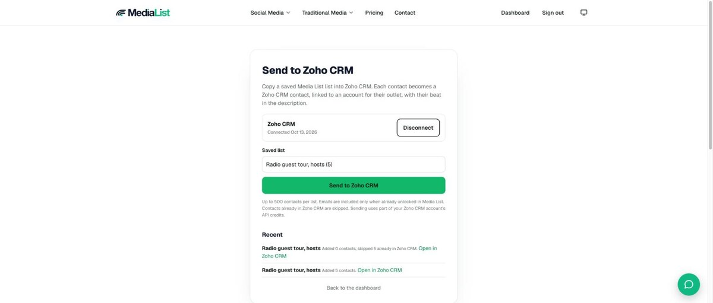
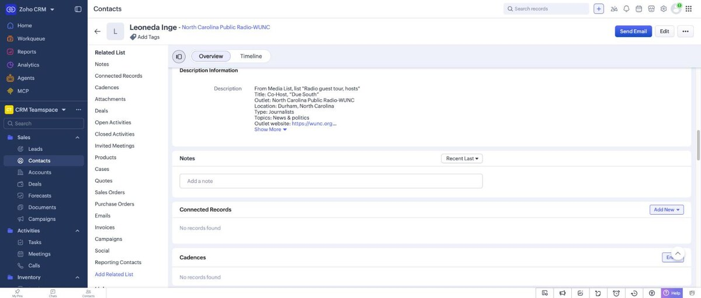

# Media List for Zoho CRM

Send a saved Media List list of journalists, editors, podcast hosts and creators into Zoho CRM, one contact per person.

[Media List](https://medialist.com) helps agencies, publicists and founders find the right people to pitch.

## What you need

- A Media List account with an active plan or free trial ([medialist.com/pricing](https://medialist.com/pricing))
- A Zoho CRM account (any data center)

## Set up

1. Sign in at [medialist.com](https://medialist.com) and save a list of contacts from the dashboard.
2. Go to [medialist.com/zoho](https://medialist.com/zoho) and click **Connect Zoho CRM**.
3. On Zoho's screen, click **Accept**.

## Send a list

1. On [medialist.com/zoho](https://medialist.com/zoho), pick a saved list.
2. Click **Send to Zoho CRM**. The page updates by itself.
3. Click **Open in Zoho CRM** to see the new contacts.

## What each contact contains

| Zoho CRM field | Value |
|---|---|
| First name, last name | Contact name |
| Account name | The contact's outlet (an existing account with the same name is reused) |
| Title | Contact title |
| Email | Included only when unlocked in Media List |
| Description | Title, outlet, location, type, topics, outlet website and Media List ID |

## Good to know

- Up to 500 contacts per send.
- Sending a list again adds only new contacts. Contacts already in Zoho CRM (same email, or same name at the same account) are skipped.
- Media List adds records with Zoho workflows turned off, so your automations never email the journalists it adds.
- Each send uses part of your Zoho CRM API credits.
- Media List asks Zoho only for access to read and create contacts and accounts, read your organization name, and search records.

## Disconnect

Click **Disconnect** on [medialist.com/zoho](https://medialist.com/zoho). Media List deletes its stored access and asks Zoho to revoke it. You can also remove Media List in Zoho under My Account, Connected Apps.

## Support

Email [support@medialist.com](mailto:support@medialist.com).

[Privacy policy](https://medialist.com/privacy) and [Terms of service](https://medialist.com/terms)
